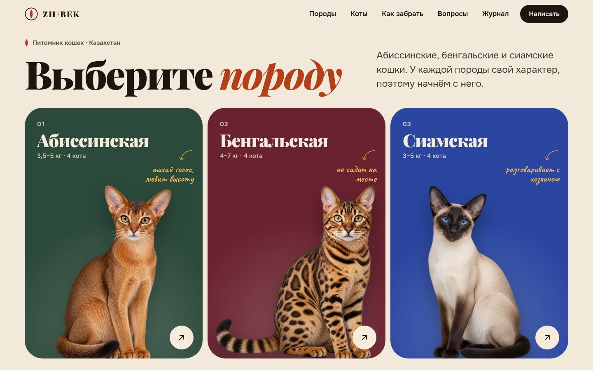
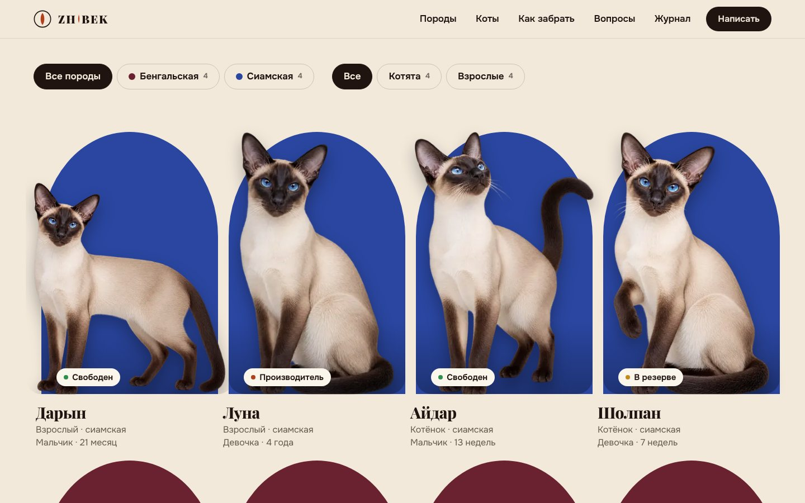
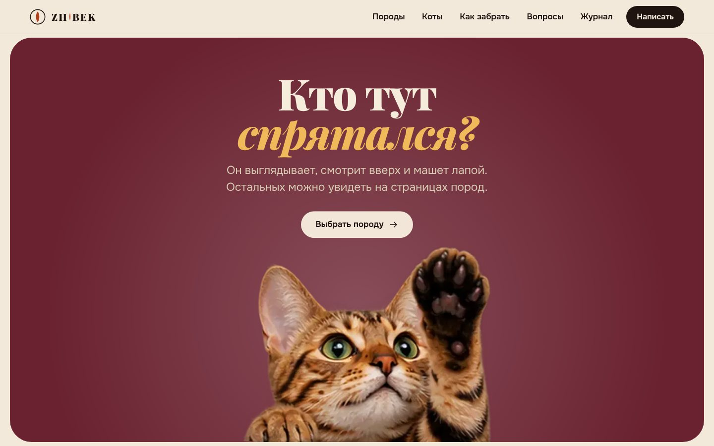
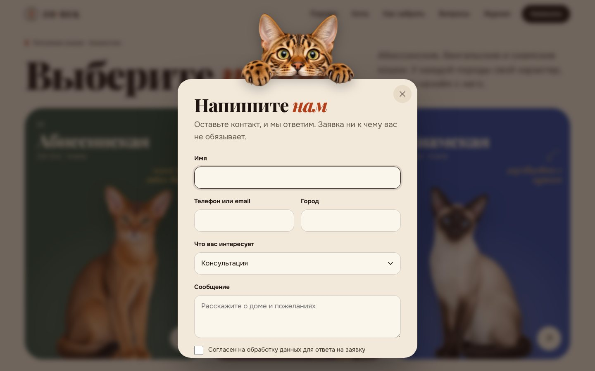

# ZHIBEK — сайт питомника абиссинских, бенгальских и сиамских кошек

Тема и плагин для WordPress, версия 5. Посетитель выбирает породу и видит котов этой породы: котят и взрослых вместе. Котов владелец добавляет сам. Без конструкторов страниц, библиотек анимации и внешних сервисов: шрифты, скрипт и картинки лежат внутри темы.

**Название.** ZHIBEK (Жібек) по-казахски «шёлк». В логотипе буква I заменена вертикальным зрачком кошки.



| Коты | Анимация кота при прокрутке | Заявка |
|------|----------------------------|--------|
|  |  |  |

Все превью: [`docs/preview/`](docs/preview/). Идея и структура: [`docs/plan.md`](docs/plan.md).

## Как устроен сайт

| Страница | Что на ней |
|----------|-----------|
| Главная | выбор породы (три цветные панели) → бегущая лента → коты → анимация кота при прокрутке → сравнение характеров → «как забрать» с нитью, которая тянется при прокрутке → доставка с картой → вопросы → журнал → финал, где кот собирается из точек и разлетается от курсора |
| `/breeds/` | три породы крупными полосами |
| `/breeds/{порода}/` | порода на своём цвете, название за котом, пометки от руки на коте, оценки характера, текст, коты этой породы с фильтром «котята / взрослые», галерея, соседние породы |
| `/cats/` | все коты с фильтром по породе и возрасту |
| `/cats/{кот}/` | фото в арке, возраст, пол, окрас, родители, кнопки |
| Журнал, страницы, магазин, 404 | в той же системе |

Окно заявки: кот выглядывает из-за верхнего края окна. Пока котов нет, вместо каталога показывается аккуратное пустое состояние с котом, а не пустое место.

## Установка

Требования: WordPress 6.5+, PHP 8.0+, HTTPS. Для магазина нужен WooCommerce.

**Если установлена версия 3 или 4.** Внешний вид → Темы → Добавить → Загрузить: [`install/zhibek-theme.zip`](install/zhibek-theme.zip), WordPress предложит заменить тему. Так же замените плагин [`install/zhibek-cattery.zip`](install/zhibek-cattery.zip). При первом заходе записи «Котята» автоматически переходят в раздел «Коты», а старые адреса `/kittens/…` перенаправляются на `/cats/…`. Затем в Настройки → Постоянные ссылки нажмите «Сохранить» и в Настройки → ZHIBEK нажмите «Создать демонстрационный контент»: обновятся тексты и цвета пород (если вы их не правили).

**С нуля.**

1. Уберите прежнюю сборку: активируйте любую стандартную тему, удалите плагин *VELLARIS Cattery* и тему *VELLARIS*.
2. Внешний вид → Темы → Добавить → Загрузить: `zhibek-theme.zip`. Активируйте **ZHIBEK**.
3. Плагины → Добавить → Загрузить: `zhibek-cattery.zip`. Активируйте **ZHIBEK Cattery**.
4. Настройки → Постоянные ссылки → «Название записи» → Сохранить (иначе `/breeds/` и `/cats/` дадут 404).
5. Настройки → ZHIBEK: WhatsApp, Telegram, Instagram, телефон, email, города для карты. Нажмите **«Создать демонстрационный контент»**: появятся три породы, три статьи и страницы «Конфиденциальность» и «Доставка и оплата». Котов этот шаг не создаёт.
6. Магазин: установите WooCommerce, в Настройки → Общие выберите валюту KZT и повторите импорт (появятся четыре товара-примера).
7. Настройки → Общие: название сайта `ZHIBEK`. Установите русский языковой пакет WordPress.
8. Почта: настройте SMTP-плагин, иначе письма о заявках могут не доходить. Заявки в любом случае сохраняются в админке (раздел «Заявки ZHIBEK»).

Если на сайте стоит плагин кэширования, после замены темы очистите кэш. Если хостинг не принимает архив темы по размеру (около 14 МБ), загрузите папку `zhibek` через FTP или файловый менеджер в `wp-content/themes/`.

## Как добавлять котов

Коты → Добавить:

- **Название** — кличка. **Порода** выбирается из списка.
- **Возраст**: «Определить по дате рождения» (младше года — котёнок) или вручную «Котёнок / Взрослый».
- **Статус**: свободен, в резерве, ожидается, производитель, в новой семье. Цена необязательна.
- Пол, окрас, дата рождения, родители, описание.
- **Фото**: «Изображение записи». Лучше всего вырезанный на прозрачном фоне кот (PNG или WebP): сайт сам ставит его на цветной фон породы в арке, и все карточки выглядят единым набором. Отметьте «Главное фото вырезано на прозрачном фоне». Обычная фотография тоже подходит и показывается в арке как есть. Дополнительные снимки добавляются в блок «Фотогалерея», видео — там же.

Кот появляется на главной, в каталоге, на странице своей породы и в фильтрах. Фильтры и счётчики строятся сами: пока у породы нет котят, кнопки «Котята» не будет.

## Как редактировать

| Что | Где |
|-----|-----|
| Контакты, города на карте, демо-режим | Настройки → ZHIBEK |
| Породы: подпись, характер, факты, оценки характера (1–5), цвет, фото | Породы → редактирование |
| Тексты главной, шаги, вопросы | `theme/inc/content.php` (обычные PHP-массивы) |
| Журнал | Записи, рубрика «Журнал» (слаг `journal`) |
| Страницы (конфиденциальность, доставка) | Страницы |

Пометки от руки на коте в шапке породы строятся из полей «Факты» породы («Глаза: …», «Шерсть: …», «Вес: …», «Окрас: …») для трёх базовых пород. Для новой породы цвет задаётся в карточке, пометки не выводятся, всё остальное работает.

## Демонстрационный режим

Пока он включён, в галереях пород показываются иллюстрации из темы с пометкой, а в подвале стоит пояснение. Все картинки в теме — заглушки: их сгенерировал ChatGPT. Когда появятся свои фотографии, загрузите их в карточку породы и котов и выключите демо-режим: иллюстрации исчезнут. Магазин и товары не менялись.

Тексты написаны как для работающего питомника (родословная, ветпаспорт и чип в комплекте, возраст отдачи 12–14 недель, доставка). Пока питомника нет, это сценарий, а не обещание: не публикуйте сайт как действующий, пока условия не станут реальными, затем поправьте формулировки в `theme/inc/content.php`. Фактов о питомнике (год основания, титулы, число помётов) на сайте нет.

## Что проверено, а что нет

Тестовый домен проверялся и в браузере из среды сборки, и на локальном WordPress (PHP 8.3, SQLite) в Chromium:

- ширины 320, 360, 390, 430, 768, 1024, 1280, 1440, 1920 px, горизонтального переполнения нет;
- прокрутка пальцем и колесом, консоль без ошибок;
- меню, форма заявки, фильтры, анимация при прокрутке, окно заявки с котом, пустые состояния, режим без анимаций;
- axe-core (WCAG 2.1 AA): 0 нарушений на главной, породах, каталоге, странице кота, статье, 404, на десктопе и в мобильной версии;
- Lighthouse, главная: доступность, рекомендации, SEO 100; производительность 100 на десктопе и 90 на телефоне при замедленной сети;
- с панелью администратора WordPress, пустыми настройками, заполненными контактами и загруженными фотографиями.

**Не проверялось:** Safari и Firefox (View Transitions и scroll-driven animations там работают не везде, но без них сайт выглядит так же), реальные телефоны, WooCommerce целиком (корзина, оформление, оплата): стили написаны под стандартную разметку и должны быть просмотрены на живом сайте.

## Структура

```
install/            готовые архивы для загрузки в WordPress
theme/              тема ZHIBEK
  inc/content.php   тексты главной
  inc/helpers.php   функции шаблонов
  assets/css, js    стили и скрипт (site.js — весь клиентский код)
  assets/img        коты на прозрачном фоне, наклейки, фотографии, иконки
  assets/anim       кадры анимации кота при прокрутке
plugin/zhibek-cattery/   породы, коты, заявки, настройки
scripts/            сборка архивов, подготовка картинок и кадров, карта Казахстана
docs/               design.md, assets.md, plan.md, preview/
```

Сборка архивов: `python3 scripts/package.py` (CSS и JS в архиве сжимаются, нужен Node.js).

## Лицензии

Тема и плагин — GPL-2.0-or-later. Шрифты Onest, Playfair Display и Caveat — SIL OFL 1.1 (тексты рядом с файлами). Карта Казахстана — Natural Earth, общественное достояние. Сторонних библиотек в теме нет.
