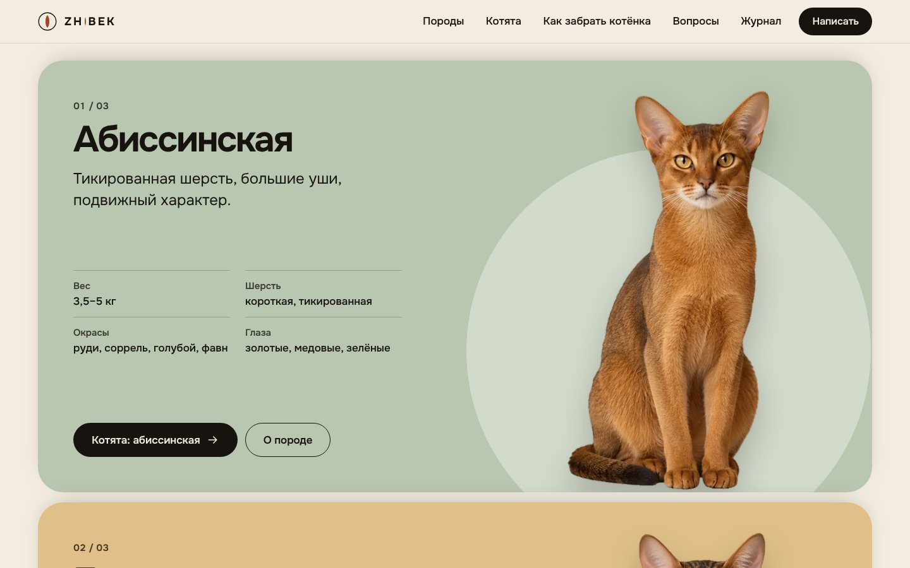
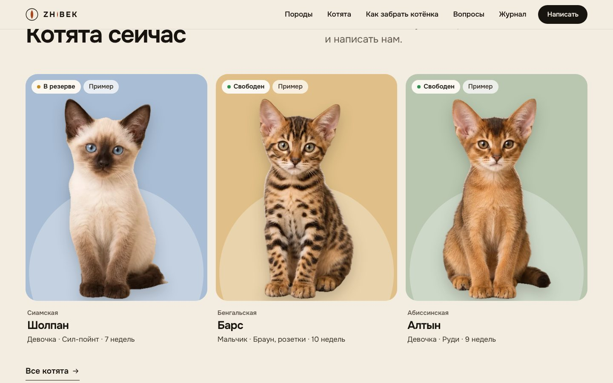
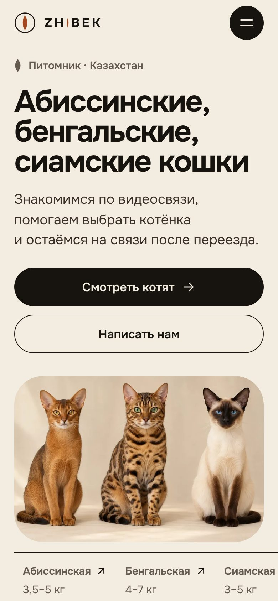

# ZHIBEK — сайт питомника абиссинских, бенгальских и сиамских кошек

Тема и плагин для WordPress, версия 4. Светлый редакционный дизайн, каталог пород и котят, заявки, магазин на WooCommerce. Без конструкторов страниц, библиотек анимации и внешних сервисов: шрифт, скрипт и картинки лежат внутри темы.

**Название.** ZHIBEK (Жібек) по-казахски «шёлк». В логотипе буква I заменена вертикальным зрачком кошки.


| Породы | Котята | Телефон |
|--------|--------|---------|
|  |  |  |

Все превью: [`docs/preview/`](docs/preview/).

## Что изменилось в версии 4

Версия 3 была построена на десяти закреплённых сценах, плавном скролле и шейдерах. На практике это давало тяжёлую страницу на 27 экранов с пустыми участками, пикселями в шейдере меха и текстом, который уходил за край на телефоне. Версия 4 собрана заново:

- светлый тёплый дизайн вместо чёрно-золотого, один шрифт (Onest) вместо пары с засечками, текст крупнее и контрастнее;
- структура главной: первый экран, три панели пород, котята, как забрать котёнка, доставка, магазин (если подключён WooCommerce), вопросы, журнал, связаться;
- прокрутка средствами браузера: `position: sticky` для стопки пород, CSS scroll-driven animations для лёгкого параллакса, появление блоков через `IntersectionObserver`;
- переход между страницами через View Transitions API: карточка котёнка плавно становится его страницей;
- вес главной около 340 КБ на телефоне против 1,2 МБ (JS — 6 КБ вместо 236 КБ), фото в трёх размерах;
- все тексты переписаны: факты и понятные действия, без штампов.

## Установка

Требования: WordPress 6.5+, PHP 8.0+, HTTPS. Для магазина нужен WooCommerce.

**Если установлена версия 3.** Внешний вид → Темы → Добавить → Загрузить: [`install/zhibek-theme.zip`](install/zhibek-theme.zip), WordPress предложит заменить тему. Затем так же замените плагин [`install/zhibek-cattery.zip`](install/zhibek-cattery.zip). В Настройки → ZHIBEK нажмите «Создать демонстрационный контент»: тексты демо-пород, котят и статей обновятся (только те, что вы не правили).

**С нуля.**

1. Уберите прежнюю сборку: активируйте любую стандартную тему, удалите плагин *VELLARIS Cattery* и тему *VELLARIS*. Старые демо-записи остаются в базе, сайт их не показывает.
2. Внешний вид → Темы → Добавить → Загрузить: [`install/zhibek-theme.zip`](install/zhibek-theme.zip). Активируйте **ZHIBEK**.
3. Плагины → Добавить → Загрузить: [`install/zhibek-cattery.zip`](install/zhibek-cattery.zip). Активируйте **ZHIBEK Cattery**.
4. Настройки → Постоянные ссылки → «Название записи» → Сохранить (иначе `/breeds/` и `/kittens/` дадут 404).
5. Настройки → ZHIBEK: WhatsApp, Telegram, Instagram, телефон, email, города для карты. Нажмите **«Создать демонстрационный контент»**: появятся три породы, три котёнка-примера, три статьи и страницы «Конфиденциальность» и «Доставка и оплата».
6. Внешний вид → Меню: при желании соберите своё меню и назначьте на «Главное меню». Без меню используется стандартное.
7. Магазин: установите WooCommerce, в Настройки → Общие выберите валюту KZT и повторите импорт (появятся четыре товара-примера).
8. Настройки → Общие: название сайта `ZHIBEK`. Установите русский языковой пакет WordPress.
9. Почта: настройте SMTP-плагин, иначе письма о заявках могут не доходить. Заявки в любом случае сохраняются в админке (раздел «Заявки ZHIBEK»).

Если на сайте стоит плагин кэширования (LiteSpeed Cache, WP Rocket и т. п.), после замены темы очистите кэш.

## Как редактировать

| Что | Где |
|-----|-----|
| Контакты, города на карте, демо-режим | Настройки → ZHIBEK |
| Породы: подпись, характер, факты, «Подойдёт, если», «Важно знать», цвет фона | Породы → редактирование |
| Котята: пол, окрас, дата рождения, родители, цена, статус, фото | Котята → редактирование |
| Статьи журнала | Записи, рубрика «Журнал» (слаг `journal`) |
| Тексты главной, шаги, комплект, вопросы | `theme/inc/content.php` (обычные PHP-массивы) |
| Страницы (конфиденциальность, доставка) | Страницы |

**Котята.** Когда появятся настоящие котята, добавьте их и выключите демо-режим в настройках: карточки-примеры исчезнут из каталога. Статус «В резерве» и «В новой семье» показывается меткой на карточке. Цена необязательна: пустое поле ничего не выводит.

**Фотографии.** Лучше всего работает вырезанный кот на прозрачном фоне (PNG или WebP): сайт сам ставит его на цветной фон породы, и все карточки выглядят как один набор. Загрузите файл в «Изображение записи» и отметьте «Главное фото вырезано на прозрачном фоне». Обычная фотография тоже подходит и показывается как есть. Дополнительные снимки добавляются в блок «Фотогалерея».

## Пока питомника нет

Сайт сейчас — макет: питомник ещё не открыт, поэтому всё содержимое — заглушки.

- **Фотографии, котята, родители, товары — заглушки.** Демо-режим включён по умолчанию: на карточках стоит метка «Пример», в подвале — пояснение. Магазин и товары не менялись.
- **Тексты описывают работающий питомник** (родословная и ветпаспорт в комплекте, передача лично или доставка, возраст отдачи 12–14 недель). Пока питомника нет, это сценарий, а не обещание: не публикуйте сайт как действующий, пока условия не станут реальными, затем поправьте формулировки в `theme/inc/content.php`.
- Фактов о питомнике (год основания, награды, титулы, число помётов) на сайте нет.

Когда питомник откроется:

1. Добавьте настоящих котят со своими фотографиями и выключите демо-режим.
2. Замените большие кадры в `theme/assets/img/scenes` (подробности в [`docs/assets.md`](docs/assets.md)).
3. Впишите реквизиты (ИП/ТОО, БИН/ИИН, адрес) на страницах «Конфиденциальность» и «Доставка и оплата».
4. Для `.kz`-домена проверьте требования к размещению сервера.
5. Подключите платёжный модуль (например, Halyk ePay или FreedomPay): онлайн-оплата в сборку не входит.

## Что проверено, а что нет

Тестовый домен из задачи недоступен из среды разработки, поэтому проверка шла на локальном WordPress (PHP 8.3, SQLite) в Chromium:

- ширины 320, 360, 390, 430, 768, 1024, 1280, 1440, 1920 px, горизонтального переполнения нет;
- прокрутка пальцем (touch-события) и колесом на всей главной, консоль без ошибок;
- меню, форма заявки (проверка полей, отправка, сохранение), фильтр котят, лайтбокс, вопросы, якоря, переход между страницами;
- axe-core (WCAG 2.1 AA): 0 нарушений на всех типах страниц, на десктопе и в мобильной версии;
- Lighthouse, главная: доступность 100, рекомендации 100, SEO 100, производительность 100 на десктопе и 98 на телефоне при замедленной сети (замер на локальном сервере без кэша);
- панель администратора WordPress (шапка и закреплённые блоки сдвигаются под неё), пустые настройки и заполненные контакты, загруженные фотографии вместо вырезок.

**Не проверялось:** Safari и Firefox (View Transitions и scroll-driven animations там работают не везде, но без них сайт выглядит так же, только без плавных переходов), реальные телефоны, WooCommerce целиком (корзина, оформление, оплата): стили написаны под стандартную разметку и должны быть просмотрены на живом сайте.

## Структура

```
install/            готовые архивы для загрузки в WordPress
theme/              тема ZHIBEK
  inc/content.php   тексты главной
  inc/helpers.php   функции шаблонов
  assets/css, js    стили и скрипт (site.js — весь клиентский код)
  assets/img        вырезки котов, студийные кадры, товары, иконки
plugin/zhibek-cattery/   породы, котята, заявки, настройки, демо-контент
scripts/            сборка архивов, вырезка фона, увеличение, карта Казахстана
docs/               design.md, assets.md, preview/
```

Сборка архивов: `python3 scripts/package.py` (CSS и JS в архиве сжимаются, нужен Node.js).

## Лицензии

Тема и плагин — GPL-2.0-or-later. Шрифт Onest — SIL OFL 1.1 (текст рядом с файлом). Карта Казахстана — Natural Earth, общественное достояние. Сторонних библиотек в теме нет.
