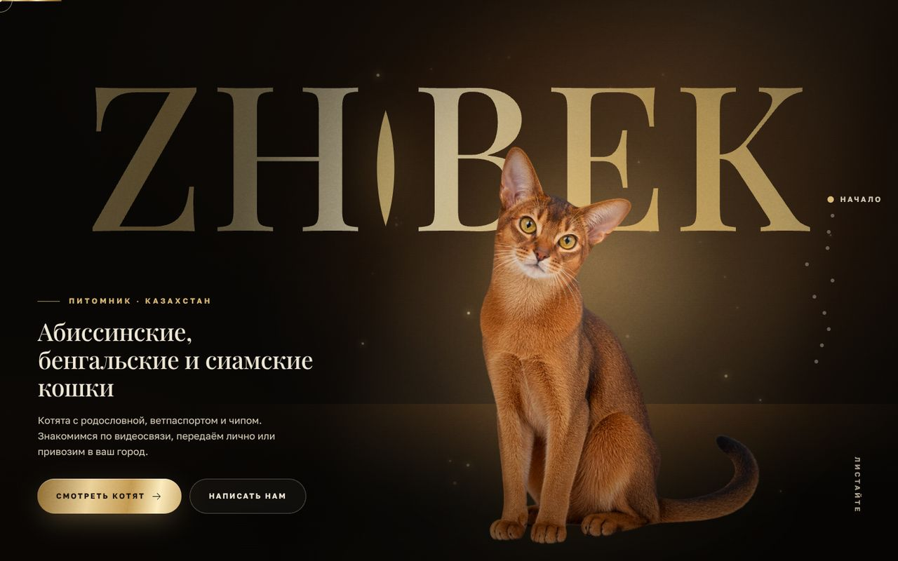

# ZHIBEK — сайт питомника абиссинских, бенгальских и сиамских кошек

Полная переработка сайта для Казахстана: новое название, дизайн-система, кинематографичная главная со сценами скролла, WebGL-эффекты, каталог пород и котят, магазин WooCommerce. Тема и плагин для WordPress, без конструкторов страниц и внешних сервисов: шрифты, скрипты и картинки лежат внутри темы.

**Название.** ZHIBEK (Жібек) — по-казахски «шёлк». Шерсть всех трёх пород короткая и шелковистая; название легко читается латиницей и кириллицей. В логотипе буква I заменена вертикальным зрачком кошки.

## Что внутри



Главная — один непрерывный сюжет из десяти сцен:

| № | Сцена | Что происходит |
|---|-------|----------------|
| 1 | **Врата** | Тёмные створки с золотой радужкой. Сами приоткрываются, при прокрутке распахиваются (CSS 3D), камера входит внутрь. |
| 2 | **Герой** | Название ZHIBEK за спиной абиссинской кошки (текст между слоями), свет следует за курсором, пылинки в луче. |
| 3 | **Взгляд** | Процедурный WebGL-глаз: радужка, щелевой зрачок, роговица. Приближение синхронно со скроллом, цвет глаза меняется золото → зелень → синева. |
| 4 | **Три мира** | Закреплённая сцена: абиссинская (солнце и бронза), бенгальская (тёмное золото, шейдер «меха» из розеток), сиамская (луна и жемчуг). При прокрутке назад всё проигрывается в обратном порядке. |
| 5 | **Портреты** | Горизонтальная галерея с параллаксом; клик раскрывает кадр на весь экран. |
| 6 | **Родословная** | Интерактивное дерево на три поколения: линии рисуются при прокрутке, клик по предку подсвечивает его линию. |
| 7 | **Коллекция котят** | Карточки с 3D-наклоном, фильтр по породам, «сохранённые». Клик — карточка перелетает в главное фото страницы котёнка. |
| 8 | **Процесс и карта** | Пять шагов от заявки до переезда и точечная карта Казахстана с городами. |
| 9 | **Магазин, журнал, вопросы** | Магазин появляется, если подключён WooCommerce. |
| 10 | **Финал** | Кошка собирается из тысяч золотых частиц и разлетается от курсора. |

Между страницами — переход «шёлк»: полупрозрачная ткань проходит через экран (WebGL, запасной вариант — плавное затемнение).

Внутренние страницы: каталог и страница породы, каталог котят, страница котёнка с 3D-«паспортом», журнал, статьи, 404, магазин, корзина, оформление заказа.

Превью: [`docs/preview/`](docs/preview/) (десктоп и мобильная версия).

## Установка

Требования: WordPress 6.5+, PHP 8.0+, HTTPS. Для магазина — WooCommerce.

1. **Уберите прежнюю сборку.** Внешний вид → Темы: активируйте любую стандартную тему. Плагины: деактивируйте и удалите *VELLARIS Cattery*, затем удалите тему *VELLARIS*. Старые демо-записи (породы, котята, заявки прежней сборки) в базе остаются, но сайт их не показывает; при желании удалите.
2. Внешний вид → Темы → Добавить → Загрузить: [`install/zhibek-theme.zip`](install/zhibek-theme.zip). Активируйте **ZHIBEK**.
3. Плагины → Добавить → Загрузить: [`install/zhibek-cattery.zip`](install/zhibek-cattery.zip). Активируйте **ZHIBEK Cattery**.
4. Настройки → Постоянные ссылки → «Название записи» → Сохранить (иначе страницы `/breeds/` и `/kittens/` дадут 404).
5. Настройки → ZHIBEK: укажите WhatsApp, Telegram, Instagram, телефон, email, города для карты. Нажмите **«Создать демонстрационный контент»**: появятся три породы, три котёнка-примера, три статьи, страницы «Конфиденциальность» и «Доставка и оплата».
6. Внешний вид → Меню: при желании соберите своё меню и назначьте на «Главное меню». Без меню используется стандартное.
7. Магазин: установите WooCommerce, в Настройки → Общие выберите валюту KZT и повторите импорт (появятся четыре товара-примера).
8. Настройки → Общие: название сайта `ZHIBEK`, краткое описание можно оставить пустым. Установите русский языковой пакет WordPress.
9. Почта: настройте SMTP-плагин, иначе письма о заявках могут не доходить. Заявки в любом случае сохраняются в админке (раздел «Заявки ZHIBEK»).

## Как редактировать

| Что | Где |
|-----|-----|
| Контакты, города на карте, демо-режим | Настройки → ZHIBEK |
| Породы: подпись, характер, факты, «Подойдёт, если», «Важно знать», цвет глаз | Породы → редактирование |
| Котята: пол, окрас, дата рождения, родители, цена, статус, фото | Котята → редактирование |
| Статьи журнала | Записи, рубрика «Журнал» (slug `journal`) |
| Тексты главной, список «В комплекте», шаги, вопросы | `theme/inc/content.php` (обычные PHP-массивы) |
| Страницы (конфиденциальность, доставка) | Страницы |

**Котята.** Добавьте настоящих котят, затем выключите демо-режим в настройках: карточки-примеры исчезнут из каталога. Статус «В резерве» и «В новой семье» показывается меткой на карточке. Цена необязательна: пустое поле ничего не выводит.

**Фотографии.** Лучше всего работает вырезанный кот на прозрачном фоне (PNG или WebP): сайт сам ставит его на фирменный фон породы, и все карточки выглядят единым набором. Загрузите файл в «Изображение записи» и отметьте «Главное фото вырезано на прозрачном фоне». Обычная фотография тоже подходит и показывается как есть. Дополнительные снимки добавляются в блок «Фотогалерея». Для пород загрузите вырезку, иначе используется картинка из темы. Рекомендуемый размер вырезки — от 1000 px по высоте.

## Важно перед запуском

- **Фотографии в теме — иллюстрации** (сгенерированные изображения из прежней сборки), а не фото вашего питомника. Они нужны, чтобы показать дизайн. Замените их своими.
- **Проверьте формулировки.** Список «В комплекте с котёнком» (родословная, ветпаспорт, чип, договор, стартовый набор, поддержка), шаги процесса, ответы в блоке «Вопросы» (возраст отдачи 12–14 недель, видеозвонок, доставка) — типовые условия питомников. Поправьте под свои в `inc/content.php`. Фактов о питомнике (год основания, награды, титулы) нет: придуманного нет.
- Родословная на главной — пример, имена вымышленные (отмечено на странице). Для настоящих котят имена родителей вводятся в карточке.
- Страницы «Конфиденциальность» и «Доставка и оплата» — каркас: впишите реквизиты (ИП/ТОО, БИН/ИИН, адрес) и условия возврата.
- Для `.kz`-домена проверьте требования к размещению сервера.
- Онлайн-оплата не подключена: подключите платёжный модуль, который выберете (например, Halyk ePay или FreedomPay).

## Идеи из чата: что вошло и что нет

| Идея | Решение |
|------|---------|
| The Royal Entrance (врата) | **Вошла.** Щель между створками — это зрачок, поэтому врата и «взгляд» читаются как одна история. |
| Light Reveals (свет за курсором) | **Вошла** в герое, на телефоне свет дрейфует сам. |
| Zoom Into the Eye, WebGL-глаз | **Вошла.** Процедурный шейдер без картинок, цвет глаза по породам. |
| Three Worlds | **Вошла**, сердце главной. Цвета и свет у каждой породы свои. |
| Fur Universe (мех бенгала) | **Вошла** как шейдер розеток в мире бенгальской. |
| Private Collection | **Вошла**: коллекция котят и переход «карточка → страница». |
| Digital Royal Passport | **Вошла** на странице котёнка (3D-книжка, открывается при прокрутке). |
| Worldwide Feline Family (глобус) | **Заменена** картой Казахстана с городами: питомник работает по стране. |
| Liquid Metal Typography | **Вошла**: золотой блик на названии. |
| Cinematic Focus Pull | **Вошла**: герой выходит из размытия при открытии врат. |
| Silk Page Transitions | **Вошла** — и совпала с названием («жибек» — шёлк). |
| Particle Transformation | **Вошла один раз** — финал с кошкой из частиц. |
| Living Sculpture (золотая 3D-кошка) | Нет: без хорошей модели 3D-кошка выглядит как персонаж игры. Вместо неё — настоящие фотографии и шейдеры. |
| Shadow Walk (тень-силуэт) | Нет как отдельная сцена: нет видео с кошкой на прозрачном фоне. Её роль играет тень и свет в герое. |
| Kitten Time Machine, 360° Portrait, Living Portraits | Нет: нужны съёмки котят в разном возрасте, с разных ракурсов и видео. Страница котёнка уже принимает галерею и видео — когда материал появится, это можно добавить. |
| Luxury Sound Experience | Нет: звук не проверить без устройств, раздражает посетителей, добавляет вес. |

## Что проверено, а что нет

Тестовый домен из задачи был недоступен из среды разработки (сетевая политика), поэтому сборка проверялась на локальном WordPress (PHP 8.3, SQLite) в Chromium:

- десктоп 1920×1080, 1440×900, 1280×720, 1024×768; планшет 768×1024; телефон 390×844;
- режим «уменьшить движение» и браузер без WebGL (все сцены имеют статичный запасной вариант);
- форма заявки (отправка, сохранение, проверка полей), фильтры, избранное, лайтбокс, меню, переходы, паспорт;
- консоль без ошибок.

**Не проверялось:** Safari и Firefox, реальные телефоны (производительность WebGL на слабых устройствах), WooCommerce целиком (корзина, оформление, оплата): стили написаны под стандартную разметку WooCommerce и должны быть просмотрены на живом сайте. Блок магазина на главной проверен на тестовой заглушке.

## Производительность и доступность

- Первая загрузка главной ≈ 1,2 МБ (из них шрифты 160 КБ, JS 236 КБ, героиня 170 КБ); картинки ниже первого экрана грузятся лениво.
- WebGL-сцены рисуют только когда видны. Разрешение шейдера ограничено; на телефонах меньше частиц и ниже разрешение.
- Уважается `prefers-reduced-motion`; в подвале есть выключатель анимаций. Без движения сцены превращаются в обычные блоки.
- Клавиатура, `skip-link`, `aria`-метки, видимый фокус, нативный `<dialog>` для формы.

## Структура

```
install/            готовые архивы для загрузки в WordPress
theme/              тема ZHIBEK
  inc/content.php   тексты главной
  inc/helpers.php   функции шаблонов
  assets/css, js    стили и скрипты (gl.js — WebGL, home.js — сцены главной)
  assets/img        вырезки котов, сцены, товары, иконки
plugin/zhibek-cattery/   породы, котята, заявки, настройки, демо-контент
scripts/            подготовка ассетов: вырезка фона, карта Казахстана
docs/               design.md, assets.md, preview/
```

## Лицензии

Тема и плагин — GPL-2.0-or-later. Шрифты Playfair Display и Golos Text — SIL OFL 1.1 (тексты рядом с файлами). GSAP — [лицензия GreenSock](https://gsap.com/standard-license) (текст в `theme/assets/js/vendor`), Lenis — MIT. Карта Казахстана — Natural Earth, общественное достояние.
